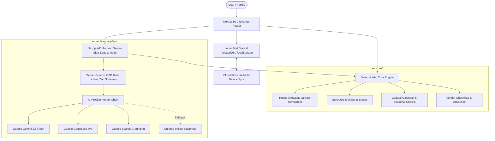

# Architecture & Technical Design

Utsav (उत्सव) is an India-first AI celebration and event planning platform designed for weddings, birthdays, and community festivals. It combines deterministic financial and temporal engines with Google's GenAI ecosystem.

## Architectural Layers

| Layer                   | Directory                     | Responsibilities                                                                                                                                                                                           | Dependencies                          |
| :---------------------- | :---------------------------- | :--------------------------------------------------------------------------------------------------------------------------------------------------------------------------------------------------------- | :------------------------------------ |
| **Core Engine**         | `src/core/`                   | Exact rupee allocation, largest-remainder math, schedule and timeline calculations, ICS calendar generation, vendor state transitions, cultural preset functions. Pure deterministic TypeScript functions. | None (zero runtime dependencies)      |
| **AI Layer**            | `src/ai/`                     | Google Gemini 2.5 integration via `@google/genai`, prompt construction, structured output schemas, 7-tool conversational function calling, model chain failover.                                           | `@google/genai`, Zod                  |
| **Server & API**        | `src/server/`, `src/app/api/` | Edge security, per-request nonces, strict Content-Security-Policy (CSP), in-memory IP rate limiting, input/output validation, memoization.                                                                 | Next.js server runtime, Zod           |
| **Store & Persistence** | `src/store/`                  | Local-first persistence (`localStorage`), reactive subscription hooks, optional Firebase Cloud Firestore synchronization.                                                                                  | `firebase/firestore`, `firebase/auth` |
| **User Interface**      | `src/ui/`, `src/app/`         | Accessible React 19 components, Three.js serial light visual canopy, multi-tab planning dashboard, interactive assistant drawer.                                                                           | React 19, Motion, Three.js            |
| **Localization (i18n)** | `src/i18n/`                   | Pan-Indian typed dictionaries for English, हिन्दी (Hindi), தமிழ் (Tamil), and తెలుగు (Telugu).                                                                                                             | None                                  |

## Core Principles

1. **Deterministic Finance & Scheduling**:
   - GenAI models never perform budget arithmetic or date math directly.
   - The model returns percentages and relative offsets; pure deterministic TypeScript code in `src/core/allocate.ts` and `src/core/schedule.ts` computes the exact rupees and dates.
2. **Local-First & Privacy Preserving**:
   - Full event planning functionality operates completely offline without mandatory accounts.
   - Data persists locally with optional multi-device family sharing via Firebase Firestore.
3. **Defense-in-Depth Security**:
   - Zero client-side API keys (`GEMINI_API_KEY` stays exclusively on the server).
   - Per-request nonce CSP headers, strict same-origin checks, and body size limits.
